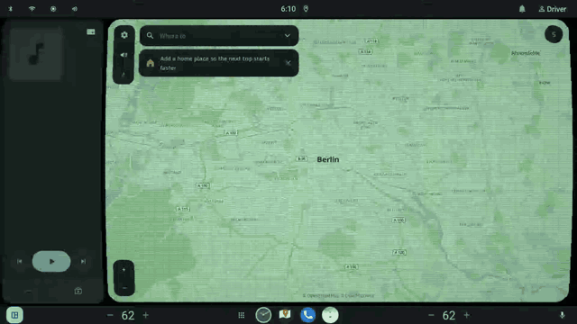

# CarSystemUI Retro Overlay

Eight retro looks (VHS, NTSC, scanlines, CRT, curved CRT, green and amber phosphor, Technicolor)
put on a Scalable UI task panel, by a `DecorPanel` that never reads the app's pixels.

A **pod**: an `android_library` wired into `CarSystemUI` through Dagger, using Scalable UI's
public controller surface and SurfaceFlinger's per-layer properties. No change to
`car-scalable-ui-lib`, `car-wm-shell-lib` or the platform.



## How it works

SurfaceFlinger will not run a custom shader on another app's layer, so each look is split into
the parts the compositor can do on its own:

| Part | Where | What |
|---|---|---|
| colour | `RetroTint`: `Transaction.setColorTransform` on the task leash | monochrome, green/amber phosphor, Technicolor two-strip, VHS desaturation: one 3x3 matrix, multiplied in at composition, zero copies |
| alpha overlay | `RetroOverlayView`: AGSL `RuntimeShader` on the panel's own view | scanlines, vignette, flicker, grain, tracking bar, scratches, curved glass edge, drawn as black- and white-with-alpha and composed with SrcOver |
| geometry | `RetroBarrel`: N `SurfaceControl.mirrorSurface` strips of the task leash | the curved-crt barrel: each strip is the task's buffer read again with its own horizontal scale `1 + 0.028 * intensity * y^2`, over an opaque cover that hides the flat original |

What the split cannot do: anything that samples a neighbour or moves the coordinate per pixel.
VHS keeps grain, desaturation and the tracking bar but loses the horizontal jitter and the R/B
split; NTSC keeps only its scanlines; the CRT aperture mask becomes two dark columns out of
three, since SrcOver dims every channel alike.

`RetroController` watches its own panel's variant (`StateManager.PanelStateObserver`). While the
panel is visible it puts the look on its targets and clears it when the panel hides or the
controller is destroyed. The panel XML owns when the look is on.

Targets, two modes:

| `<OverlayPanelId>` | targets | the overlay's `on` variant |
|---|---|---|
| names a task panel | that one panel | its bounds, one layer above it |
| absent | every task panel on the overlay's display | the whole display, above all task panels |

In whole-display mode the controller observes every panel, so a task that moves takes its strips
along, and all strips bend about the display's centre so neighbouring tasks form one glass.

A rounded task panel (`<Corner>`) keeps its corners: the leash is rounded and the mirrors
inherit it, so the cover is cut with the same four radii, and in one-panel mode the overlay
ends at the target's own rounded corner and is transparent beyond it, where the display shows
through. On such a panel the barrel always fits (`retro_barrel_fit` or not): strips wider than
the panel would carry its rounded corner past the arc as a sliver of the flat app, so every
strip is at most the panel's width and the cover shows as black arcs at the sides. The
whole-display mode keeps its black bezel and its own fit knob. Otherwise a black ring and black
corners sit on the panel.

A target in transition keeps its barrel: between StateManager's start and end callbacks the
controller moves the existing strips and cover every frame (a commit-stage Choreographer
callback, after the animators) with `setPosition`/`setScale`/`setCrop`; a drag moves the same
way. Mirrors are rebuilt only when the look goes on or a target got a new task leash. Other
decor panels (bars, grips) stay flat and untinted; the display area leash cannot be mirrored
instead, its decor children would mirror the overlay itself.

Touch: the overlay view clears its touchable region on attach, so taps fall through to the task.
The barrel's mirrors are `InputConfig::CLONE` layers and never take input; the cover is a colour
layer without an input channel; the real task stays the touch target under both.

## Tested on

| | |
|---|---|
| AOSP | `aosp-17_r1`, Android 17 (SDK 37), build `CP2A.260605.016` |
| Lunch target | `sdk_car_dewd_x86_64-userdebug` |
| Emulator | `emulator_car64_x86_64`, 1920×1080 @ 140 dpi (also 2560×1440) |
| Layout | the DEWD landscape reference (`dewd-land-res-base`) |

### Which emulator to build

Use the **DEWD** car target, `sdk_car_dewd_x86_64`: it is the AOSP product that ships Scalable
UI switched on. The plain `sdk_car_x86_64` target does not, and the pod has no panels to
follow there.

```
source build/envsetup.sh
lunch sdk_car_dewd_x86_64-userdebug
m
emulator -gpu host -cores 3 -memory 6096 -no-snapshot-save -writable-system
```

`-writable-system` lets you push a rebuilt `CarSystemUI` and the RRO without reflashing. On an
emulator the hardware composer drops the colour matrix, so the tint shows only on the layers
that go through the GPU path; disable the composer once per boot to see the whole look:

```
adb shell service call SurfaceFlinger 1008 i32 1
```

## Requirements

- `aosp-17_r1`. The pod uses `DecorPanelControllerBase`, `StateManager.PanelStateObserver`,
  `PanelPool`, `TaskPanel` and `PanelControllerMetadata` as they are in that release, and the
  `SurfaceControl` calls `mirrorSurface` and `setColorTransform` that SystemUI already uses.
- `CarSystemUI-Shared` buildable in your tree; the pod's only static dependency.
- A Scalable UI layout with at least one task panel to put the look on.

## Install

Two edits in `packages/apps/Car/SystemUI`, then a build. `tools/install.sh` makes the two edits
(idempotent, `--check` only reports); by hand they are:

1. Clone into the pods directory:

   ```
   git clone https://github.com/passenger6/car-systemui-retro-overlay-pod.git \
       packages/apps/Car/SystemUI/pods/retro-overlay
   ```

2. Register the library in `Android.bp`:

   ```diff
    carsysui_pods = [
   +    "CarSystemUI-Retro-Overlay",
   ```

3. Include the Dagger module in
   `src/com/android/systemui/car/wm/scalableui/panel/controller/PanelControllerModule.java`:

   ```diff
   +import com.android.systemui.car.retro.RetroPanelModule;

   -@Module(includes = { MinimizedControlsPanelModule.class })
   +@Module(includes = { MinimizedControlsPanelModule.class, RetroPanelModule.class })
   ```

4. Build:

   ```
   m CarSystemUI RetroOverlayRRO
   ```

The module binds `RetroController.Factory` and `RetroOverlayView` into Scalable UI's controller
and view maps; nothing else in SystemUI refers to the pod. A layout that does not name the
controller never loads it.

### Install with an agent

The repository carries `AGENTS.md` (how a pod plugs into CarSystemUI, the map of the code, the
invariants, how to verify) and `tools/install.sh`, so a coding agent in your AOSP checkout can
do the wiring. A prompt that works for Claude Code or Codex, run from the root of the tree:

```
Clone https://github.com/passenger6/car-systemui-retro-overlay-pod.git into
packages/apps/Car/SystemUI/pods/retro-overlay, read its AGENTS.md and README.md, run
tools/install.sh and show me the diff it made. Do not build; tell me the build and push
commands instead.
```

For your own layout, add to the prompt which task panel should get the look:

```
Then make the sample's one-panel configuration for my layout: the target is <panel id> in
<path to my RRO>/res/xml/<panel>.xml. Fill templates/retro_overlay.xml and
templates/retro_overlay_controller.xml from that panel, put them in my RRO's res/xml/ and add
@xml/retro_overlay to its window_states.
```

After the build and the push, `tools/verify.sh` is the acceptance check the agent can run
itself (read-only adb).

## Run the sample

`samples/RetroOverlayRRO` is the DEWD landscape reference layout with the overlay panel added:
the reference's panels come in as the `dewd-land-res-base` resource library, the RRO itself
holds only `window_states`, the retro XML files and the knob overrides. `CarSystemUI`'s own
`window_states` is empty, so an RRO always carries a whole layout, and enabling this one
replaces the layout the image came with.

```sh
adb root && adb remount
adb push $OUT/system_ext/priv-app/CarSystemUI/CarSystemUI.apk /system_ext/priv-app/CarSystemUI/
adb push $OUT/system_ext/overlay/RetroOverlayRRO.apk /system_ext/overlay/
adb shell cmd overlay enable --user current com.android.systemui.rro.retro
adb shell pkill -f com.android.systemui
```

Which user's overlay set SystemUI obeys is build-dependent; read it back with
`cmd overlay list --user <id>` for 0 and for the current user. SystemUI restarts on its own.
Then switch the look on and off:

```
adb shell cmd statusbar carsysui-dispatch-event retro_on
adb shell cmd statusbar carsysui-dispatch-event retro_off
```

`tools/verify.sh` checks the result on the device, one PASS/FAIL line per item.

The sample ships in whole-display form (`@xml/retro_screen` in `window_states`): green phosphor,
curved, 24 strips, over every task panel. Swap the item for `@xml/retro_overlay` to put the look
on `map_panel` alone; `res/values/config.xml` has both lines and the reason for the numbers.

## Panel XML

For another layout, fill `templates/retro_overlay.xml` and `templates/retro_overlay_controller.xml`
(the placeholders are explained at the top of each file), put them into that project's
`res/xml/` and add `@xml/retro_overlay` to its `window_states`. The
controller names the target task panel:

```xml
<Controller id="retro_overlay_controller">
    <ControllerName>com.android.systemui.car.retro.RetroController</ControllerName>
    <View>com.android.systemui.car.retro.RetroOverlayView</View>
    <OverlayPanelId>map_panel</OverlayPanelId>
</Controller>
```

The overlay panel's `on` variant should sit on the target's bounds, one layer above it, and
follow the target's transitions; the sample RRO's `retro_overlay.xml` mirrors DEWDLand's
`map_panel` (its opened bounds, layer 3 over its 2; a `paused` variant mirrors the map's
covered/returned events so the look pauses under Settings or the keyguard and comes back with
the map, while `retro_off` stays off) and
adds `retro_on` / `retro_off` for the editor and for `dispatch-event`.

## Knobs (RRO-overridable)

`res/values/config.xml`:

| Resource | Default | Meaning |
|---|---|---|
| `string/retro_preset` | `green-crt` | `vhs`, `ntsc`, `scanlines`, `crt`, `curved-crt`, `green-crt`, `amber-crt`, `technicolor` |
| `integer/retro_intensity_percent` | 55 | how strong the look is, 0..100 |
| `bool/retro_curved` | false | curved glass on top of any preset: the barrel and the rounded edge of curved-crt without its scanlines and mask; curved-crt is curved regardless |
| `integer/retro_scanline_spacing_px` | 6 | distance between dark lines, display px |
| `integer/retro_barrel_strips` | 24 | strips of the curved-crt barrel; 0 = no mirrors, no cover, glass edge only |
| `bool/retro_barrel_cover` | true | opaque cover under the mirrors; false = mirrors over the live app (diagnostic) |
| `bool/retro_barrel_outward` | false | true = widest row in the middle, rows narrow towards top and bottom (a tube); false = edge-first curve, the widest rows at top and bottom |
| `bool/retro_barrel_fit` | false | true = widest rows fit the task and the middle shrinks (black arcs at the sides, nothing cut); false = stretch, edge rows cut off |
| `integer/retro_noise_percent` | 0 | film grain on top of any preset, new every frame |
| `integer/retro_noise_size_px` | 1 | size of one grain in display px; 2..4 is visible at arm's length on 2560 px |
| `integer/retro_barrel_bulge_percent` | 100 | multiplier on the barrel; 100 = 0.028 * intensity (~1.5 % at the edges), 300 is obvious |
| `integer/retro_tracking_percent` | 0 | VHS tracking bar on top of any preset, with a 2 px wobble of the lines as it passes |
| `integer/retro_jitter_percent` | 0 | VHS shake: the mirror strips move sideways per frame and get pulled under the bar; needs strips > 0, one strip = one band |
| `bool/retro_monochrome` | false | luma-only output on top of the tint |
| `bool/retro_animate` | true | flicker, grain and tracking move |

## Trying values without a build

Every knob above can be overridden on a running device with a `debug.retro.<name>` property;
the controller reads the knobs each time the look is put on:

```sh
adb shell setprop debug.retro.preset amber-crt
adb shell setprop debug.retro.bulge 300
adb shell cmd statusbar carsysui-dispatch-event retro_off
adb shell cmd statusbar carsysui-dispatch-event retro_on
```

Names: `preset`, `intensity`, `curved`, `spacing`, `noise`, `noise_size`, `tracking`, `jitter`,
`strips`, `bulge`, `cover`, `fit`, `outward`, `monochrome`, `animate`. Percent knobs take 0..100,
booleans `true`/`false`. An empty value (`setprop debug.retro.preset ""`) goes back to the
resource; a reboot clears all of them. The `debug.` namespace is readable by every process
(`get_prop(domain, debug_prop)` in sepolicy), so no permission is involved.

To walk through the presets: loop `preset` over `scanlines crt curved-crt green-crt amber-crt
vhs ntsc technicolor` with an off/on between each.

## Verifying on a device

Logs are tagged `[retro]` (`RetroController`, `RetroOverlayView`, `RetroBarrel`).

- Send `retro_on` / `retro_off` the way any custom event is sent (the editor's simulate, or the
  device's dispatch-event); the line `tint green-crt on app_panel` must appear and the app must
  stay tappable through the overlay.
- Green/amber wrong (greyish instead of tinted) means the matrix order is transposed: the JNI
  reads the nine floats column-major (`ui::mat3`), `RetroTint.columnMajor` does the transpose.
- Open or close an app while the barrel is up: the log shows `following [app_panel]` and
  `frames started`, then `settled [app_panel] moved=true` with no `barrel hidden`/`barrel
  shown` pair in between; the bent picture must move with the panel, not jump at the end.
- `curved-crt`: `dumpsys SurfaceFlinger` lists `retro-cover` and the mirror strips under the
  overlay's surface; `top` on `surfaceflinger` with 0 and with 24 strips says what they cost.
  On an emulator without host GPU, RenderEngine is SwiftShader and every strip is CPU work.
